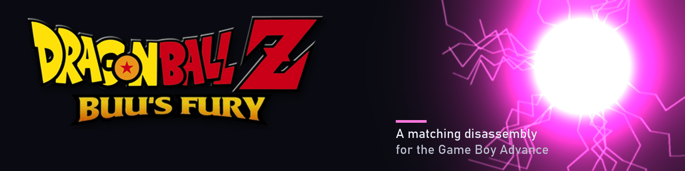

<!-- TODO demo GIF: a short capture of extract.cmd, rebuild.cmd and the gate printing GATE PASS, saved as docs/demo.gif. -->
<!-- TODO social preview: set a repository social image in Settings once the banner exists. -->
<p align="center"></p>

# Dragon Ball Z: Buu's Fury disassembly

**A byte-exact disassembly of Dragon Ball Z: Buu's Fury (GBA, USA) that rebuilds the original ROM from tracked source.**


## Contents

- [What this is](#what-this-is)
- [What this is not](#what-this-is-not)
- [Progress](#progress)
- [Building](#building)
- [Tests](#tests)
- [Repository layout](#repository-layout)
- [Credits and license](#credits-and-license)

## What this is

The program code is ARM and Thumb assembly in `asm/`. ARM Developer Suite 1.2 assembles and links
it back into the retail ROM, and the build checks the result against the retail sha256. The game's
graphics, audio, text and record tables are rebuilt at build time by generators that decode them
from your own copy of the game and re-encode them byte for byte.

It builds one ROM:

* Dragon Ball Z: Buu's Fury (USA), sha1 `f1c4b07554d2a3b1ad2f325307051e775ce68087`

## What this is not

This is not a decompilation. Almost all of the game's code is still assembly, and only a handful of
small C files exist in `src/`. Most functions are still named by their address (`sub_08000158`,
`loc_0800016A`): 2,866 of the 3,025 functions the census classifies. Naming them is the next
readability step, and `tools/lint/lints.py` holds the count to a measured baseline with
`tools/lint/NAMING_LEDGER.csv` as the record of every promotion; `tools/research/name_evidence.py
--mode audit` checks every row's evidence against your own copy of the image. No part of the code is
claimed to match the original compiler's C output.

The progress figure below measures how much of the ROM the build produces from tracked source. It
does not measure how much of the code has been turned into C.

## Progress

94.0959 % of the ROM (7,893,334 of 8,388,608 bytes) builds from tracked source: assembly, tables
with named fields, and generators that rebuild assets from your own ROM. The rest is still copied
into the build as raw slices of the original image. `python tools\gate\gate.py` prints the split,
and [docs/DEFINITION_OF_DONE.md](docs/DEFINITION_OF_DONE.md) says what counts as source.

Of what remains, 3.9214 % is identified binary (328,954 B): bytes whose purpose is known but which
still have no reader that rebuilds them.

## Building

The build runs on Windows. You need ARM Developer Suite 1.2, Python 3.12 with `pytest` and
`capstone`, grit, Visual Studio or Build Tools 2022 with the C++ workload, and your own copy of the
game saved as `baserom.gba`. [INSTALL.md](INSTALL.md) has the details, and
[docs/README.md](docs/README.md) is the guide to the code once it builds.

```
extract.cmd
rebuild.cmd
python tools\gate\gate.py
```

`extract.cmd` builds the compressor from its own source when it is absent, and `rebuild.cmd` builds
it on the first run, so the three commands need no manual step before them. The gate rebuilds from
scratch and prints `DIGEST MATCH` and `GATE PASS` when the output equals the retail ROM. Every step
writes only ignored files.

## Tests

`python -m pytest -q tools` runs every test file in the tree, and a test that needs your ROM, ARM
Developer Suite 1.2 or `cmd.exe` skips itself and names the one that is absent. The GitHub Actions
workflow runs the same command on `ubuntu-latest` without the game.

## Repository layout

| Path | Contents |
| --- | --- |
| `asm/` | the game's code and data as assembly |
| `src/` | the few parts already written in C |
| `include/` | shared assembler and C declarations |
| `tools/` | what builds the ROM and what checks it; [tools/README.md](tools/README.md) lists every entry |
| `docs/` | a reader's guide to the code and the game's data; [docs/NEWCOMER.md](docs/NEWCOMER.md) walks from a clone to a changed function |
| `work/` | the byte ledger the gate reads |
| `assets/`, `build/` | what `extract.cmd` and `rebuild.cmd` write from your own ROM; never tracked |

## Credits and license

This tree starts from the [2genkidev/buusfury](https://github.com/2genkidev/buusfury) disassembly.
Third-party code and credits are listed in [NOTICE](NOTICE). Changes are listed in
[CHANGELOG.md](CHANGELOG.md).

No ROM, BIOS or extracted game data is included. You need your own legally obtained copy of the
game. Not affiliated with pret, Nintendo, Atari, Bandai or Webfoot Technologies.

MPL-2.0, see [LICENSE](LICENSE).
