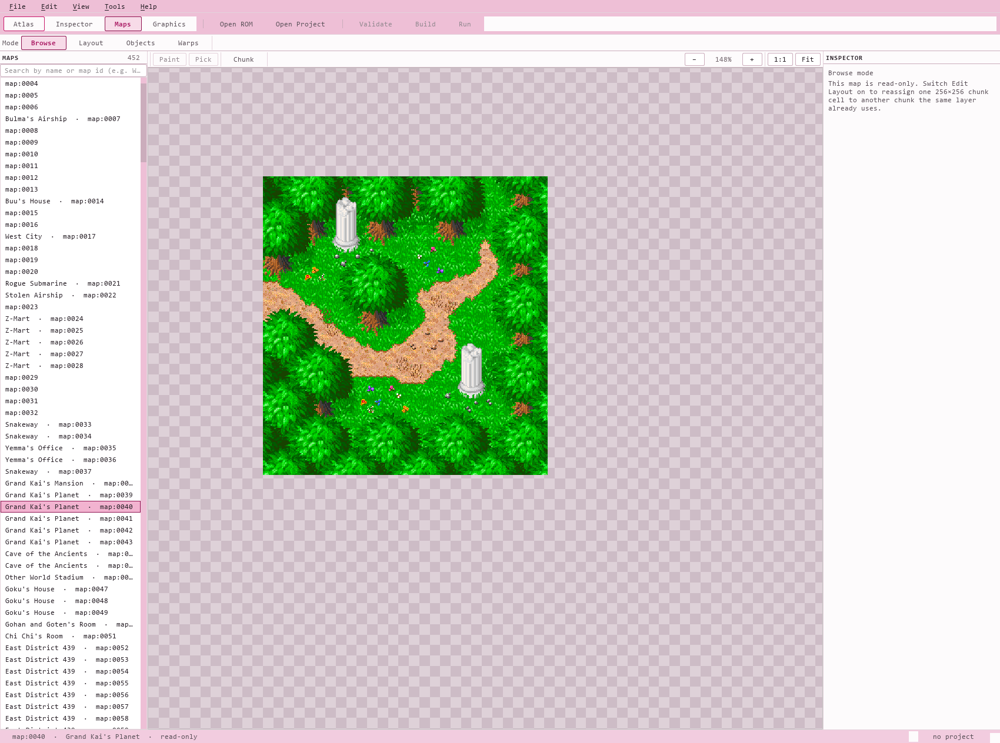
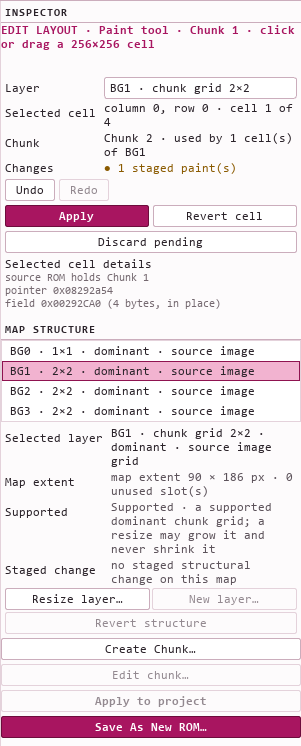

# DragonByte Z / Webfoot SDK

**DragonByte Z** is the desktop editor for the **Webfoot SDK**, a modern modding
and authoring toolkit for Webfoot's Game Boy Advance Dragon Ball Z games -
*The Legacy of Goku*, *The Legacy of Goku II* and *Buu's Fury*. It opens a legally
obtained ROM as an inspectable, versionable project, lets an author change and
create game content through real editor surfaces, and builds a new ROM image for
the original engine to run. **The product goal is not a standalone remake.** The
acceptance target is authored Legacy of Goku content running inside the actual
Legacy of Goku II/Buu's Fury engine. Buu's Fury currently leads as the measurement
target; the architecture is intended for all three games.

> **No ROM is included.** This repository contains no game data files. You supply your
> own legally obtained copy of the game, and the toolkit refuses an image it
> cannot identify against a configured profile.

## What it can do

**Find and inspect anything the SDK has classified.**
Atlas search covers the whole game by name, map or id - including text the game
keeps compressed - without knowing a ROM address, and the Inspector shows the
fields that have actually been recovered, under evidence-supported names, rather
than a plausible guess.

**Edit content the game already contains.**
Mapped dialogue lines can be rewritten, and a replacement longer than the line it
replaces is relocated and built; the retail dialogue box has displayed a longer
authored line in full. Shared object palette entries can be recoloured, and
supported objects can be selected, added and moved directly on the rendered map.

**Author maps, tiles and chunks.**
All 452 maps render from immutable ROM bytes, layer by layer, at zoom. A layer's
existing chunks can be painted onto 256x256 chunk cells with undo, redo and an
eyedropper; a chunk the layer did not have can be created and painted with, and
its 32x32 plane rearranged from graphics that layer already draws. Every one of
those edits is saved and reopened like any other authored content, and the retail
engine has drawn the authored result after the area is rebuilt.

**Change map structure.**
A supported layer's chunk grid can be grown - top-left anchored, so existing cells
keep their coordinates - and an unused layer slot can be activated with a new
supported layer. The engine's own camera clamp is raised with the grid, so the
added ground is actually reachable, and the grown layer was confirmed in the
retail engine. Shrinking, unsupported layer forms and shared map roots are refused
with a stated reason.

**Transitions (warps).**
All 735 transition records are read with no anomalies. A map's existing
connections can be listed and retargeted - destination, arrival position and
facing - and a transition the canonical image does not contain can be created,
both through the normal project and build path. Every supported transition is
drawn on the map as the region that triggers it, where a click selects it and a
drag moves it. The retail engine has consumed an authored destination, and a
transition created in DragonByte Z and placed above the original end of the ROM
was found and consumed by the retail engine on 2026-09-27.

**Entities, behavior and scripts.**
An entity that is not present in the original map data can be cloned and
configured, given an author-written script, and tied to a deliberate gameplay
trigger. The original engine has executed the authored bytes and rendered the
result on screen, and the authored script ran only when the player satisfied the
chosen trigger rather than at load.

**Author text beyond its retail slot.**
A line longer than the one it replaces is placed in verified writable space and
the owning table entry is repointed, so the engine resolves and renders the whole
authored message. Creating entirely new text-table ids is not claimed.

**Build deterministically, safely and reproducibly.**
`extract` -> `validate` -> `build`: a project validates before it builds, repeated
builds are byte-identical, and a build writes a new image while refusing to write
over its source. A build may expand the 8 MiB retail image to 16 MiB and allocate
authored data above the original end. Save As writes a provenance manifest beside
the ROM, and the application reopens its own emitted image only when that manifest
proves it is the canonical ROM plus exactly the declared edits.

**Work in one window, from search to emulator.**
DragonByte Z names its four primary editors on one strip - Atlas, Inspector, Maps
and Graphics - with Open ROM, Open Project, Validate, Build and Run beside them.
The Maps editor keeps its own modes (Browse, Layout, Objects and Warps) instead of
splitting them across tabs, and the whole loop stays in one window: find a record,
inspect it, edit it, author new content, validate, build, and run the emitted ROM
in a configured emulator.

## Current status

**20 / 24 capabilities (83%).** That is the exact count reported by the
repository's capability registry,
[`src/data/capabilities.json`](src/data/capabilities.json), which is the single
authority for what is shipped: READ 5 / 5, EDIT 8 / 8, AUTHOR 3 / 7,
DELIVER 4 / 4.

**Phase 2 - complete map editing - is complete.** Tile painting, chunk creation,
map resizing and layer authoring, and warp and connection editing have all
shipped, the last of them runtime-proven in the retail engine. The **next major
capability is graphics import**, the first step of Phase 3, which is chosen and
not started. The full route to 1.0 is in the
[roadmap](docs/ROADMAP_TO_1_0.md).

## What makes this different

- **Proof in the real engine.** Nothing is called shipped on a passing test
  alone. Runtime claims are confirmed in the retail engine itself: a derivative
  is built, run in an emulator under a human operator, and watched by a read-only
  observer that records what actually happened. Each capability records how its
  own result was proven.
- **Reverse engineering is not counted as a feature.** Knowing what a structure is
  and being able to author with it are tracked separately, so a complete
  measurement never inflates the capability list.
- **Deterministic builds.** The same verified base ROM, project and SDK version
  produce a byte-identical image; independent author-and-build runs have produced
  the same file.
- **Immutable input.** The original ROM is read-only and is never a write target.
  Every write goes to a new file, staged to temporary paths and verified before it
  is published, so a failed build cannot damage what you already have.
- **Provenance and tests.** A build can emit a manifest recording exactly what
  changed, and the tool reopens its own output only when that record proves it is
  the canonical image plus the declared edits. Portable tests use synthetic byte
  fixtures, never ROM-derived data.
- **Fail closed.** Anything the SDK has not measured - an unsupported format, an
  edit that would cross a shared structure, a ROM that does not match a known
  profile - is refused with a stated reason instead of being guessed, and
  unsupported content is shown read-only rather than silently reinterpreted.

## Screenshots / project site

Both images are real captures of DragonByte Z working on a verified Buu's Fury
ROM.



*Browse mode: every one of the 452 maps renders from immutable ROM bytes, layer by
layer.*



*Layout mode: a staged chunk-cell paint on map:0064, with the map-structure list
beside it.*

The public progress site is
<https://webfoot-sdk.siruiusamory.workers.dev/> - a shorter, always-current view
of the same capability list.

## Getting started

Requirements: Windows PowerShell, Git, [`uv`](https://docs.astral.sh/uv/) on
`PATH` (setup installs Python 3.12 if it is missing), and mGBA for the Run action
and optional runtime research.

```powershell
git clone <repository-url>
cd log1-remake
Set-ExecutionPolicy -Scope Process Bypass
.\scripts\setup.ps1
.\.venv\Scripts\Activate.ps1
```

Keep a legally obtained ROM outside version control - the ignored `roms\`
directory is the usual place - then identify it, extract a project, and build:

```powershell
webfoot identify ".\roms\Dragon Ball Z - Buu's Fury (U).gba"
webfoot extract  ".\roms\Dragon Ball Z - Buu's Fury (U).gba" ".\work\my-mod" --no-graphics
webfoot validate ".\work\my-mod" --rom ".\roms\Dragon Ball Z - Buu's Fury (U).gba"
webfoot build    ".\work\my-mod" --rom ".\roms\Dragon Ball Z - Buu's Fury (U).gba" --output ".\build\my-mod.gba"
```

The desktop editor needs the PySide6 extra
(`uv pip install -e ".[workbench]"`) and starts from `DragonByte Z.cmd` or with
`python -m tools.webfoot.workbench`.

Read next: [project format](docs/project-format.md),
[Workbench](docs/workbench.md), [architecture](docs/architecture.md) and
[verified project state](docs/PROJECT_<local-state-name>). The portable suite runs with
`.\scripts\test.ps1`.

## Contributing and documentation

[`CONTRIBUTING.md`](CONTRIBUTING.md) is the practical entry point for a change.
The rules behind it are
[`docs/DEVELOPMENT.md`](docs/DEVELOPMENT.md) (engineering policy),
[`docs/REVIEW.md`](docs/REVIEW.md) (the review gate) and
[`docs/ROM_SAFETY.md`](docs/ROM_SAFETY.md) (the safety contract).
[`docs/README.md`](docs/README.md) indexes everything else, including the
[reverse-engineering methodology](docs/reverse-engineering.md), the
[testing gates](docs/testing.md) and the
[route to 1.0](docs/ROADMAP_TO_1_0.md).

The project is active and not yet 1.0, so the development rules above are also
where an unsupported or unmeasured case is described: the toolkit refuses what
it has not measured rather than guessing.

## Repository layout

```text
tools/webfoot/       the shipping SDK: identification, formats, project, build
tools/webfoot/workbench/   DragonByte Z, the desktop editor
tools/runtime/       emulator capture toolbox (mGBA, GDB, Lua probes)
tools/ghidra/        static-analysis helpers
tools/research/      read-only ROM research adapters
tools/qa/            visual and interaction capture tooling
tools/export/        resource exporter
tools/quality/       repository gates: public surface, purity, readability, built site
src/                 the public progress site (Astro)
tests/unit/          portable tests, synthetic fixtures only
tests/integration/   ROM-gated tests, skipped without a configured image
docs/                documentation; start at docs/README.md
config/roms.yaml     the trusted profile catalog
scripts/             setup, test and packaging entry points
```

## Legal / ROM policy

- This repository does not distribute ROMs and contains no game data. You must
  supply your own legally obtained ROM, and the toolkit refuses an image it cannot
  identify against a configured profile.
- The verified input ROM is opened read-only. It is never overwritten, patched or
  copied into an output.
- Generated output - built ROMs, saves, save states, memory dumps, extracted
  assets and build directories - is local and is not committed, and it must stay
  that way. Do not open issues or merge requests containing ROM-derived data.
- The two screenshots under `public/` are the one deliberate exception: captures
  of the editor working on the author's own verified copy, cropped only, showing
  the tool rather than a distributable asset. Nothing else rendered from a game
  is tracked.

## Project status / experimental warning

The project is active and not yet 1.0. Supported operations are deliberately
narrower than the goal: some planned capabilities are unfinished or missing,
several editor surfaces are read-only for forms that have not been measured, and
unverified inputs fail closed. Treat built images and project documents as
experimental, keep your own backups, and expect the project file format to change
before 1.0.

## License

The Webfoot SDK and the other original code in this repository are licensed under
the [Mozilla Public License 2.0](LICENSE), a file-level copyleft: modifications to
these files stay open, while a larger work that merely uses the SDK does not
inherit the license. Commercial use is permitted. Third-party material keeps its
own license, which the root license does not override; see
[`THIRD-PARTY-NOTICES.md`](THIRD-PARTY-NOTICES.md).
